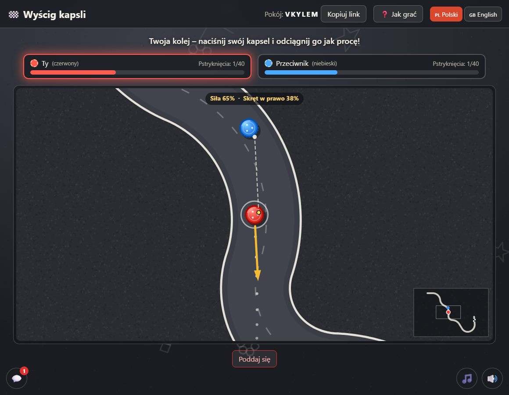
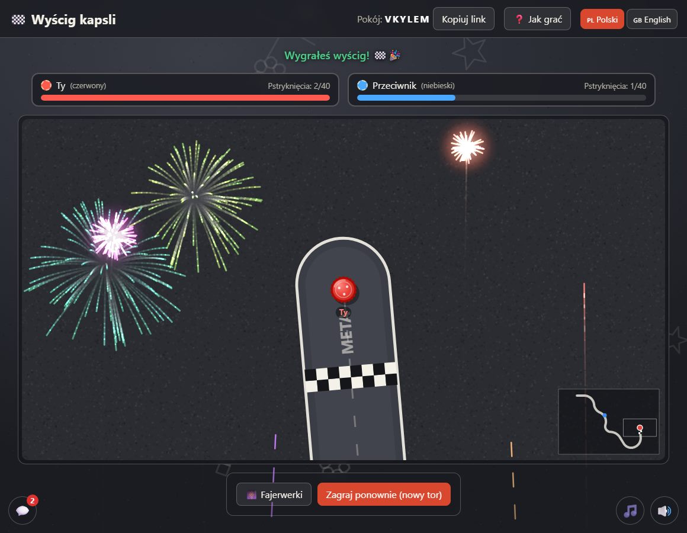
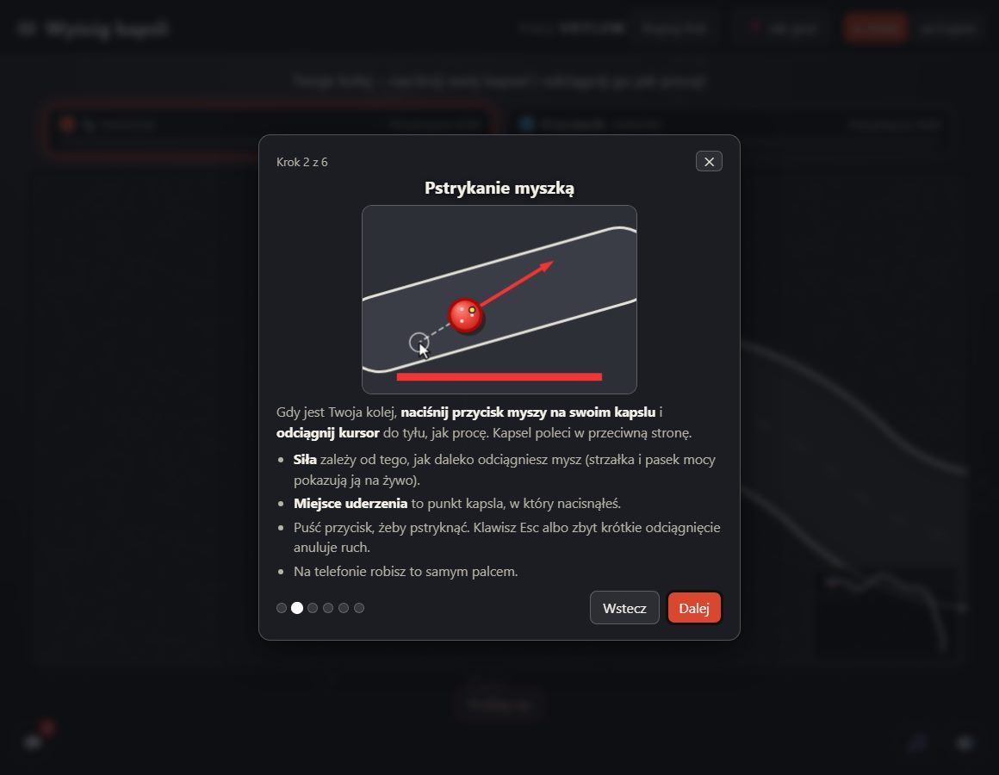
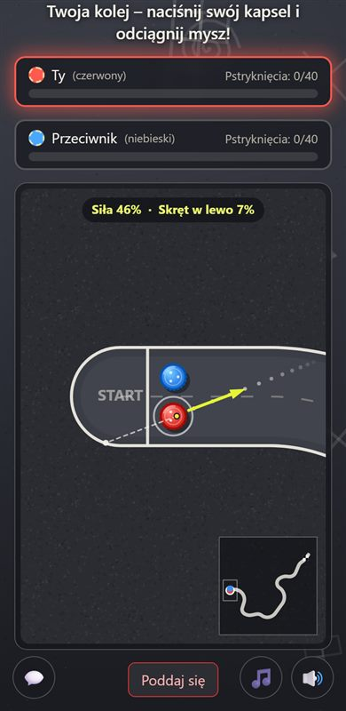

# 🏁 Wyścig kapsli – gra dla dwóch osób w przeglądarce

🇬🇧 [English version](README.md)

Podwórkowy klasyk, **wyścig kapsli**, dla **dwóch osób**: w sieci domowej albo **przez internet**. Każdy gracz ma jeden kapsel, a oboje ścigacie się po **losowo wygenerowanym torze** narysowanym kredą na asfalcie. Kapsel pstrykasz myszką (albo palcem): **miejsce uderzenia** decyduje o rotacji, a **odciągnięcie kursora** o sile. Wygrywa kapsel, który pierwszy minie linię mety. W grze są: czat, kod QR do dołączania z telefonu, interfejs po polsku i angielsku, kredowe rysunki na torze i w tle, rytmiczna elektroniczna muzyka wyścigowa, efekty dźwiękowe i fajerwerki dla zwycięzcy.

Można grać **ze znajomym** albo **z komputerem** (poziom łatwy lub trudny). Nie trzeba instalować żadnych bibliotek: wystarczy **Node.js**. Serwer jest sędzią: losuje tor, liczy fizykę każdego pstryknięcia i przekazuje wynik obu graczom. Gra powstała na bazie [WarShips](../WarShips/README.pl.md) i [Dots](../Dots/README.pl.md) i korzysta z ich infrastruktury (pokoje, tunel Cloudflare, czat, zabezpieczenia).

<p align="center">
  
  
</p>
<p align="center">
  
  
</p>

---

## Spis treści
1. [Zasady gry](#1-zasady-gry)
2. [Czego potrzebujesz i instalacja](#2-czego-potrzebujesz-i-instalacja)
3. [Uruchomienie serwera](#3-uruchomienie-serwera)
4. [Jak grać, krok po kroku](#4-jak-grać-krok-po-kroku)
5. [Gra przez internet (tunel Cloudflare i kod QR)](#5-gra-przez-internet-tunel-cloudflare-i-kod-qr)
6. [Sterowanie i funkcje](#6-sterowanie-i-funkcje)
7. [Zatrzymanie serwera](#7-zatrzymanie-serwera)
8. [Rozwiązywanie problemów](#8-rozwiązywanie-problemów)
9. [Ustawienia i bezpieczeństwo](#9-ustawienia-i-bezpieczeństwo)
10. [Testy](#10-testy)
11. [Struktura projektu (dla programistów)](#11-struktura-projektu-dla-programistów)

---

## 1. Zasady gry

- Dwóch graczy, każdy ma jeden **kapsel** (kapsel pierwszego gracza jest czerwony, drugiego niebieski). Ścigacie się po **losowym torze**: kręta droga z kredowymi bandami, linią startu i szachownicą mety. Każda nowa gra i każdy rewanż mają **inny tor**. Długość (wybierana przy tworzeniu gry): **krótki**, **średni** albo **długi**.
- **Pstrykanie.** W swojej kolejce naciśnij swój kapsel i odciągnij kursor jak procę: kapsel poleci w **przeciwną stronę**. **Siła** to długość odciągnięcia (strzałka i panel na planszy pokazują ją na żywo; odciągnięcie ponad maksimum daje pełną siłę). Puść przycisk, żeby pstryknąć. Esc albo za krótkie odciągnięcie anuluje ruch.
- **Rotacja.** Miejsce, w które naciśniesz kapsel, decyduje o rotacji: uderzenie w **prawą** stronę (patrząc w kierunku lotu) **wygina lot w lewo**, w **lewą** stronę w prawo, a środek leci prosto. Przerywany podgląd pokazuje początek lotu (bez band i bez drugiego kapsla).
- **Bandy i brak skrótów.** Kapsel odbija się od kredowych band (tracąc część prędkości i rotacji) i nigdy nie opuszcza toru, więc trzeba przejechać całą trasę.
- **Zderzenia.** Kapsle zderzają się: możesz odepchnąć rywala albo zepchnąć go na bandę.
- **Kto pstryka.** Domyślnie **ten, kto jest dalej od mety** (jak w prawdziwej grze na podwórku): zawodnik z tyłu dogania, prowadzący czeka. Przy równej odległości na zmianę. Przy tworzeniu gry możesz wybrać zwykłe pstrykanie **na zmianę**.
- **Wygrywa** kapsel, który **pierwszy minie linię mety**, nawet jeśli to rywal go tam popchnął. Po **40 pstryknięciach każdego gracza** wygrywa ten, kto jest bliżej mety (przy równej odległości remis). Można się też **poddać**.
- Po grze możecie zagrać **rewanż**: powstaje nowy tor, a zaczyna drugi gracz.

## 2. Czego potrzebujesz i instalacja

| Element | Do czego | Wymagany? |
|---|---|---|
| **Node.js 18 lub nowszy** | uruchamia serwer gry | tak |
| Nowoczesna przeglądarka (Chrome, Edge, Firefox, Safari, Brave) | gra działa w przeglądarce, u obu graczy; mysz albo ekran dotykowy | tak |
| **cloudflared** (program Cloudflare) | tunel do gry przez internet | tylko do gry przez internet; **instalacja jest automatyczna** (punkt 5) |

Nie są potrzebne żadne konta (Cloudflare, GitHub itp.). Gra działa na Windows, macOS i Linuksie; dołączone pliki `.bat` są dla Windows.

**Instalacja, krok po kroku:**
1. Zainstaluj Node.js: pobierz wersję LTS ze strony <https://nodejs.org> i zainstaluj z domyślnymi ustawieniami.
2. Sprawdź w terminalu: `node --version` (powinno wyświetlić np. `v22.11.0`). Jeśli system zgłasza, że polecenie nie jest rozpoznawane, zamknij i otwórz terminal ponownie albo uruchom komputer od nowa.
3. Pobierz repozytorium: `git clone https://github.com/YeezyBuck/Browser-Games.git` (gra jest w folderze `CapRace`) albo ściągnij ZIP z GitHuba i rozpakuj.

Gra nie wymaga instalacji ani budowania: nie ma `npm install`.

## 3. Uruchomienie serwera

Wybierz jedną z opcji. Po starcie w konsoli pojawia się adres gry. Domyślny port to **3200** (WarShips używa 3000, a Dots 3100, więc wszystkie gry mogą działać jednocześnie).

### Windows – dwuklik (najprościej)
- **`uruchom.bat`** (główny): sprawdza cloudflared (w razie potrzeby proponuje instalację), uruchamia tunel, a potem grę i przeglądarkę. Gra działa w sieci domowej **i przez internet**.
- **`uruchom-bez-tunelu.bat`**: tylko sieć domowa (bez cloudflared, bez linku i kodu QR do gry przez internet).

Otworzy się okno konsoli: **nie zamykaj go w trakcie gry**. Strona gry otworzy się sama w przeglądarce (`http://localhost:3200`). Na koniec użyj przycisku **⏻ Zamknij grę** (zobacz [punkt 7](#7-zatrzymanie-serwera)).

### Terminal (Windows, macOS, Linux)
```
cd CapRace
node server.js            # tylko sieć domowa
node server.js --tunnel   # z tunelem Cloudflare (gra przez internet)
node server.js --open     # dodatkowo otwiera grę w przeglądarce
```
Skróty `npm`: `npm start` (z tunelem i przeglądarką, jak `uruchom.bat`) i `npm run local` (bez tunelu). Inny port: `PORT=3300 node server.js` (PowerShell: `$env:PORT=3300; node server.js`).

## 4. Jak grać, krok po kroku

Potrzebne są dwie osoby (albo dwie karty przeglądarki, żeby spróbować samemu).

### Gracz 1 – tworzy grę
1. Otwórz stronę gry (`http://localhost:3200`) i, jeśli chcesz, wybierz język przyciskami **Polski / English**.
2. Wybierz **długość toru** i **kto pstryka**, potem kliknij **Utwórz grę**. Pojawi się **6-literowy kod gry** oraz gotowe linki do przekazania przeciwnikowi (🌐 przez internet razem z kodem QR, 🏠 w sieci domowej).
3. Wyślij znajomemu odpowiedni link (**Kopiuj**) i poczekaj, aż dołączy.

**Gra z komputerem:** w tym samym panelu ustaw **Przeciwnik: Komputer** i wybierz **poziom** (łatwy albo trudny). Gra startuje od razu: nie ma kodu, linku, kodu QR ani czatu, a komputer zawsze zgadza się na rewanż.

### Gracz 2 – dołącza
Otwórz link od gracza 1 (kod wpisze się sam) albo otwórz stronę gry, wpisz kod w polu **Dołącz do gry** i kliknij **Dołącz**. Na telefonie możesz zeskanować kod QR.

### Rozgrywka
1. Gra zaczyna się zaraz po dołączeniu przeciwnika: oba kapsle stoją na linii startu. U góry są dwie karty z **postępem do mety** i licznikiem pstryknięć każdego gracza; świecąca karta pokazuje, **czyja jest kolej**. W rogu planszy jest minimapa całego toru, a kamera sama podąża za akcją.
2. W swojej kolejce **naciśnij swój kapsel** (miejsce, w które naciskasz, to punkt uderzenia) i **odciągnij mysz do tyłu**. Kolorowa strzałka pokazuje kierunek i siłę, panel na planszy podaje procenty i skręt, a przerywany podgląd początek lotu. Puść przycisk, żeby pstryknąć.
3. Obaj gracze oglądają lot kapsla (policzył go serwer) i słyszą pstryknięcie, odbicia od band i brzęk zderzających się kapsli. Potem kolej następnego gracza.
4. Pierwszy minij linię mety. Zwycięzca dostaje **fajerwerki** (przycisk 🎆 puszcza je ponownie). Kliknij **Zagraj ponownie** na rewanż (klikają obaj gracze).

## 5. Gra przez internet (tunel Cloudflare i kod QR)

Jeśli przeciwnik jest poza Twoją siecią domową, użyj tunelu. Nie trzeba konta ani ustawień routera.

**Automatyczna instalacja cloudflared.** Przy starcie z tunelem (`uruchom.bat`, `npm start`) serwer sprawdza, czy cloudflared jest zainstalowany. Jeśli nie, proponuje instalację (Windows: `winget`, macOS: `brew`) i pyta w konsoli (Enter = tak). Z flagą `--yes` (albo `CLOUDFLARED_AUTO_INSTALL=1`) instaluje bez pytania. Bez interaktywnej konsoli (serwer w tle) niczego nie instaluje sam. Ręcznie: `winget install Cloudflare.cloudflared`, `brew install cloudflared` albo instrukcja na <https://developers.cloudflare.com/cloudflare-one/connections/connect-networks/downloads/>.

**Kolejność startu:** `[1/3]` sprawdzenie cloudflared, `[2/3]` tunel i jego adres, `[3/3]` gra i przeglądarka. Jeśli tunel nie wystartuje, gra i tak uruchomi się w sieci domowej, a konsola pokaże powód.

Podczas czekania na przeciwnika gra pokazuje, **jaki adres komu przekazać**: 🌐 adres tunelu (`https://….trycloudflare.com/?room=KOD`) razem z **kodem QR**, który przeciwnik zeskanuje telefonem, oraz 🏠 adres w sieci domowej.

Warto wiedzieć: adres tunelu jest **tymczasowy** (za każdym razem inny), a komputer z serwerem musi pozostać **włączony**. Darmowy tunel nie przepuszcza strumieni na żywo (SSE), więc po ok. 3 s gra **sama przełącza się na transport zapasowy** (long-polling); gracze tego nie zauważą. Gra jest turowa, więc opóźnienia tunelu nie przeszkadzają: lot liczy serwer i odtwarzają go oba ekrany. Dołączyć jako drugi gracz może każdy, kto zna link **i** kod.

## 6. Sterowanie i funkcje

| Funkcja | Jak |
|---|---|
| Pstrykanie | naciśnij swój kapsel i odciągnij mysz (albo palec) do tyłu; puść, żeby pstryknąć; **Esc** (albo prawy przycisk) anuluje |
| Siła / rotacja | długość odciągnięcia / miejsce, w które naciskasz kapsel (zobacz punkt 1) |
| Poddanie się | **Poddaj się** (z potwierdzeniem) |
| Rewanż | **Zagraj ponownie (nowy tor)** po zakończeniu gry |
| Zmiana języka | przyciski **Polski / English** u góry (zapamiętywane) |
| Samouczek | przycisk **❓ Jak grać** u góry; otwiera się też sam przy pierwszej wizycie. Sześć krótkich kroków z animacjami (cel, pstrykanie, rotacja, tor i bandy, kolejka i zderzenia, wskazówki), po polsku i angielsku; działają strzałki i Esc |
| Przeciwnik komputerowy | **Przeciwnik: Komputer** przy tworzeniu gry, poziom **Łatwy** albo **Trudny**; komputer chwilę „myśli” przed każdym pstryknięciem |
| Czat | przycisk 💬 w lewym dolnym rogu; Enter wysyła, Esc zamyka; do 200 znaków |
| Muzyka / efekty | przyciski 🎵 / 🔊 (zapamiętywane); muzyka: oryginalny elektroniczny kawałek „wyścigowy” generowany w przeglądarce (ok. 126 uderzeń na minutę); dźwięki: pstryknięcie, odbicie od bandy, brzęk kapsli, meta |
| Kopiowanie linku | **Kopiuj** w panelu oczekiwania albo **Kopiuj link** u góry |
| Zamknięcie gry | **⏻ Zamknij grę** (tylko w przeglądarce na komputerze z serwerem) |
| Odświeżenie strony | nie wyrzuca z gry: sesja jest pamiętana w karcie, a trwający lot dołącza się w miejscu, w którym jest |

Kredowe rysunki (na torze: strzałki, gwiazdki, buźki, klasy, ślady opon i napis „GO!” za startem; obok toru: drobne rysunki na asfalcie) to tylko ozdoba: są rozmieszczane z seeda toru, więc obaj gracze widzą te same, i nie wpływają na fizykę. Rysunki w tle są rysowane raz, bez animacji. Efekty cząsteczkowe i fajerwerki wyłączają się, gdy system ma włączone „ograniczenie ruchu”. Na wąskich ekranach plansza zachowuje minimalną skalę, żeby kapsel był dość duży do dotknięcia.

## 7. Zatrzymanie serwera

- **Najprościej:** kliknij **⏻ Zamknij grę** u góry strony (na komputerze, na którym działa serwer) i potwierdź. Serwer i tunel się wyłączą, okno konsoli się zamknie, karta przeglądarki też spróbuje się zamknąć (Chrome/Edge/Brave zwykle to potrafią dla kart otwartych przez plik `.bat`; Firefox i Safari zwykle nie), a przeciwnik zobaczy „Gra została zamknięta”.
- Ewentualnie naciśnij **Ctrl+C** w oknie konsoli.
- Zatrzymanie serwera **kończy wszystkie trwające gry** (pokoje są tylko w pamięci).

## 8. Rozwiązywanie problemów

| Problem | Rozwiązanie |
|---|---|
| `node` nie jest rozpoznawany | Zainstaluj Node.js, otwórz **nowy** terminal albo uruchom komputer ponownie. |
| `Port 3200 jest zajęty` (`EADDRINUSE`) | Gra już działa albo port zajmuje inny program. Zamknij ją (**⏻ Zamknij grę**) lub użyj innego portu: `PORT=3300 node server.js`. |
| Przeciwnik w domu nie może otworzyć adresu | Użyj adresu „w sieci lokalnej”, nie `localhost`; oba urządzenia w tej samej sieci; jeśli zapora Windows zapyta, zezwól Node.js w sieciach prywatnych. |
| Brak adresu „przez internet” i kodu QR | Serwer działa bez tunelu: zamknij grę i uruchom **`uruchom.bat`** / `npm start`. Panel podpowiada, co zrobić. |
| „Nie znaleziono cloudflared” | Zgódź się na instalację przy starcie albo zainstaluj ręcznie (punkt 5). |
| Nie mogę złapać kapsla | Musi być Twoja kolej (karta świeci, baner to mówi); naciśnij **na kapslu** albo tuż przy nim; poczekaj, aż poprzedni lot się skończy. |
| „Odciągnij mysz dalej, żeby pstryknąć” | Odciągnięcie było za krótkie (poniżej ok. 15 pikseli traktujemy je jak anulowanie). Odciągnij mysz trochę dalej. |
| „Ta gra już nie istnieje” | Serwer został zrestartowany (pokoje są w pamięci) albo pokój wygasł po 3 godzinach bezczynności. Utwórz nową grę. |
| Brak dźwięku lub muzyki | Kliknij cokolwiek na stronie (przeglądarki blokują dźwięk do pierwszej interakcji) i sprawdź 🎵 i 🔊. |
| Strona wygląda po staremu po aktualizacji | Odśwież bez pamięci podręcznej: **Ctrl+F5**. |
| „Zbyt wiele żądań” | Zadziałał limit bezpieczeństwa. Poczekaj chwilę. |

## 9. Ustawienia i bezpieczeństwo

| Ustawienie | Działanie |
|---|---|
| `PORT` | port serwera (domyślnie 3200) |
| `--tunnel` / `TUNNEL=1` | uruchom tunel Cloudflare |
| `--open` / `OPEN_BROWSER=1` | po starcie otwórz grę w domyślnej przeglądarce |
| `--yes` / `CLOUDFLARED_AUTO_INSTALL=1` | zainstaluj cloudflared bez pytania |
| `CLOUDFLARED` | pełna ścieżka do programu `cloudflared` |

Stałe fizyki (rozmiar kapsla, szerokość toru, tarcie, rotacja, limit pstryknięć) są w obiekcie `P` w `public/engine.js`, a limity serwera w obiekcie `LIMITS` w `server.js`.

- **Komputer gra według tych samych zasad:** działa na serwerze, wybiera pstryknięcie tą samą fizyką i wysyła je tą samą, sprawdzaną drogą co ruch człowieka, więc nie może oszukiwać. Jego token nigdy nie trafia do przeglądarki.
- **Serwer decyduje o wszystkim:** losuje tor, liczy cały lot każdego pstryknięcia i metę; klient wysyła tylko punkt uderzenia i odciągnięcie, a wynik odtwarza, więc nie może oszukiwać. Każda liczba od klienta jest sprawdzana (tylko skończone liczby, z przycięciem), a pstryknięcie przyjmowane jest tylko w Twojej kolejce i dopiero po zakończeniu poprzedniego lotu.
- **6-literowy kod pokoju**, limit prób dołączenia (12/min na IP), limit zakładania pokoi (10 na 10 min na IP), maks. 300 pokoi, limit żądań (600/min na IP), limit pstryknięć (3/s na gracza), limit połączeń na żywo; pokoje wygasają po 3 godzinach bezczynności.
- **Czat:** do 200 znaków, 6 wiadomości na 10 s, tylko zwykły tekst (bez HTML), znaki sterujące i niewidoczne usuwane.
- **Nagłówki bezpieczeństwa:** Content-Security-Policy (tylko własne skrypty), `nosniff`, `X-Frame-Options: DENY`, `Referrer-Policy`.
- **Za tunelem** prawdziwy adres klienta bierzemy z nagłówka Cloudflare tylko dla połączeń z tego komputera; adresy sieci domowej widzi tylko gospodarz.
- **Przycisk zamknięcia:** żądanie wyłączenia serwera przyjmujemy tylko z komputera z serwerem, z tajnym tokenem widocznym wyłącznie dla lokalnej przeglądarki i tylko z własnej strony gry.
- **Brak kont i haseł:** każdy, kto zna kod pokoju, może dołączyć jako drugi gracz. Nie wystawiaj gry do internetu inaczej niż przez tunel (HTTPS).
- **Uwaga:** `public/engine.js` jest serwowany przeglądarkom celowo (klient rysuje tor z seeda i pokazuje podgląd lotu tą samą fizyką). Nie zawiera żadnych sekretów: serwer nigdy nie ufa obliczeniom klienta.

## 10. Testy

```
cd CapRace
npm test                 # = node engine.test.js && node bot.test.js && node test.js
```
- `bot.test.js` (7 testów): przeciwnik komputerowy: każda decyzja to legalne pstryknięcie, szybkość (trudny najwyżej ok. 0,1 s), kończy wyścig, gdy meta jest w zasięgu, całe partie bot kontra bot z ustalonymi seedami (trudny wygrywa z łatwym w 14 z 16 partii na zmianę i w 21 z 24 przy zasadzie „kto z tyłu”), determinizm.
- `engine.test.js` (31 testów): silnik: ten sam seed daje ten sam tor, 450 losowych torów (długość, brak nakładających się korytarzy, gładka krzywa), wejście pstryknięcia (anulowanie, przycinanie, znak rotacji), zasięg i skręt pstryknięcia, zderzenia (pęd, brak przyrostu energii, kapsle nigdy się nie nakładają), 1000 losowych pstryknięć na 40 torach (kapsel nigdy nie opuszcza toru), meta, determinizm, kolejność pstrykania i kredowe rysunki (deterministyczne, na torze i z dala od band).
- `test.js` (70 testów): serwer przez HTTP: pokoje i ustawienia, pokój z komputerem (natychmiastowy start, brak czatu, komputer pstryka sam, rewanż), walidacja pstryknięć, blokada „busy”, obie zasady kolejki, meta, limit pstryknięć, poddanie się, rewanż, long-polling, czat, limity, zabezpieczenia, zamykanie oraz tłumaczenia i samouczek.

## 11. Struktura projektu (dla programistów)

```
CapRace/
├── bot.js                 przeciwnik komputerowy (po stronie serwera): próbuje wielu pstryknięć prawdziwą fizyką i wybiera najlepsze
├── bot.test.js            testy przeciwnika komputerowego
├── engine.test.js         testy silnika
├── server.js              serwer HTTP: pokoje, kolejka, limity, tunel, zamykanie (bez zależności)
├── test.js                test integracyjny serwera
├── package.json           skrypty: start, local, test
├── uruchom.bat            główny start (Windows): cloudflared → tunel → gra → przeglądarka
├── uruchom-bez-tunelu.bat start bez tunelu, tylko sieć domowa (Windows)
└── public/                pliki dla przeglądarki (i wspólny silnik)
    ├── engine.js          silnik używany PRZEZ SERWER I PRZEGLĄDARKĘ: generator toru i fizyka pstryknięcia
    ├── index.html, style.css
    ├── app.js             logika klienta: ekrany, transport, czat, odtwarzanie lotu, dźwięki gry
    ├── board.js           plansza na canvasie: tor, kapsle, kamera, minimapa, celowanie myszą/dotykiem
    ├── i18n.js            tłumaczenia PL/EN
    ├── tutorial.js        samouczek w grze: kroki i animacje (jedna korzysta z prawdziwego silnika)
    ├── music.js, chalk.js elektroniczna muzyka wyścigowa (generowana) i tło z kredowymi rysunkami
    ├── fireworks.js       fajerwerki zwycięzcy
    └── vendor/qrcode.js   generator kodów QR (qrcode-generator, MIT, dołączony bez zmian)
```

**Przeciwnik komputerowy (`bot.js`).** Fizyka jest deterministyczna i szybka (ok. 1 ms na pstryknięcie), więc komputer „wyobraża sobie” kilkaset pstryknięć (kierunki w stronę kolejnych punktów toru × siła × rotacja), symuluje je tym samym silnikiem i wybiera najlepsze: według postępu, tego, jak daleko cofa rywala, i odległości od band. Przy zasadzie „kto z tyłu” gra też taktycznie: podjeżdża do rywala od tyłu bez wyprzedzania, jeśli nie musi, wyprzedza o niewielki margines i nie pozwala rywalowi skończyć z miejsca. Poziom łatwy próbuje tylko kilkunastu pstryknięć i dodaje błąd celowania.

**Jak to działa.** Tor to krzywa środkowa złożona z prostych i łagodnych łuków (promień co najmniej 130, czyli nigdy ostrzej, niż tor jest szeroki), próbkowana co 8 jednostek; generator próbuje kolejnych seedów, jeśli dwa fragmenty toru zbliżą się do siebie. Kapsel jest „w torze”, dopóki jego środek jest bliżej krzywej niż `halfW - capR`, więc bandy są obłe i nie ma skrótów. Fizyka (120 kroków na sekundę): tarcie stałe i proporcjonalne, kierunek lotu skręcający wraz z zanikającą rotacją, impulsy przy zderzeniach z bandą (sprężystość 0,6) i między kapslami (0,9). Serwer wysyła stan pokoju z **seedem** toru (klient odtwarza ten sam tor), a po pstryknięciu **trajektorię** próbkowaną 30 razy na sekundę wraz ze zdarzeniami dźwiękowymi; klienci ją interpolują. Serwer trzyma stan pokoi w pamięci; klienci dostają zmiany strumieniem **SSE** (albo **long-pollingiem**, gdy strumień nie dochodzi, np. przez tunel).

**Interfejs HTTP:**

| Metoda i adres | Opis |
|---|---|
| `POST /api/create` (`{len: s/m/l, rule: last/alternate, vs: friend/bot, level: easy/hard}`), `/api/join` | utworzenie pokoju i dołączenie (kod → token gracza) |
| `POST /api/shoot` (`{hx, hy, px, py}`: punkt uderzenia na kapslu −1..1, wektor odciągnięcia) | pstryknięcie kapsla |
| `POST /api/resign`, `/api/rematch` | poddanie się, rewanż (nowy tor) |
| `POST /api/chat` | wiadomość czatu |
| `POST /api/shutdown` | wyłączenie serwera i tunelu (tylko z lokalnego komputera, tajny token) |
| `GET /api/events` / `/api/poll` / `/api/state` | stan na żywo (SSE) / zapasowy long-polling / jednorazowy odczyt |
| `GET /api/info` | adres tunelu, adresy sieci lokalnej, długości i zasady, token zamykania (tylko lokalna przeglądarka) |

Błędy mają postać `{ "code": "…", "error": "…" }`; klient tłumaczy kod na wybrany język.

## Licencja

Udostępniane na licencji **MIT** (zobacz [LICENSE](../LICENSE)). Dołączona biblioteka kodów QR ma własną licencję MIT: zobacz [THIRD_PARTY_NOTICES.md](../THIRD_PARTY_NOTICES.md).
