# 🎮 Browser Games

🇵🇱 **Po polsku** · 🇬🇧 [English below](#english)

## Po polsku

Zbiór małych gier, w które grasz w przeglądarce, napisanych od zera, **bez zewnętrznych bibliotek** (jedyny dołączony cudzy kod to generator kodów QR, zobacz [THIRD_PARTY_NOTICES.md](THIRD_PARTY_NOTICES.md)). Gry dla dwóch osób działają w sieci domowej **albo przez internet** dzięki tunelowi Cloudflare, mają czat, kod QR do dołączania z telefonu, interfejs po polsku i angielsku, **samouczek w grze (przycisk ❓ Jak grać)**, dźwięki i muzykę generowane w przeglądarce oraz animacje na canvasie.

| Gra | Opis | Folder | Port | Instrukcja |
|---|---|---|---|---|
| ⚓ **WarShips** (statki) | klasyczna gra w statki dla dwóch osób; wybuchy na statkach, fajerwerki dla zwycięzcy, piracka scena w tle | [`WarShips/`](WarShips/) | 3000 | [PL](WarShips/README.pl.md) · [EN](WarShips/README.md) |
| ● **Dots** (kropki) | polskie „kropki” (otaczanie): pętla z własnych kropek przejmuje kropki przeciwnika; nocne niebo z konstelacjami | [`Dots/`](Dots/) | 3100 | [PL](Dots/README.pl.md) · [EN](Dots/README.md) |
| 🏁 **CapRace** (wyścig kapsli) | wyścig kapsli po losowym torze narysowanym kredą: pstrykasz myszką, miejsce uderzenia daje rotację, odciągnięcie siłę; fizykę liczy serwer | [`CapRace/`](CapRace/) | 3200 | [PL](CapRace/README.pl.md) · [EN](CapRace/README.md) |
| 🧲 **Magnets** (magnesy) | każdy ma 10 nieregularnych magnesów i stawia je na zmianę na małym polu; magnesy się przyciągają, a połączone wracają do gracza, który to wywołał; wygrywa ten, kto pierwszy pozbędzie się wszystkich | [`Magnets/`](Magnets/) | 3300 | [PL](Magnets/README.pl.md) · [EN](Magnets/README.md) |
| ✕ ○ **TicTacToe** (kółko i krzyżyk) | gra z komputerem (minimax) w jednym pliku `index.html`, wystarczy go otworzyć | [`TicTacToe/`](TicTacToe/) | – | [README](TicTacToe/README.md) |

  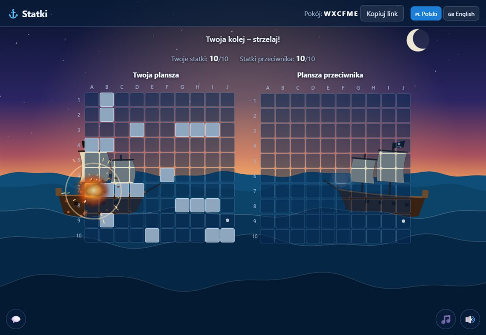
  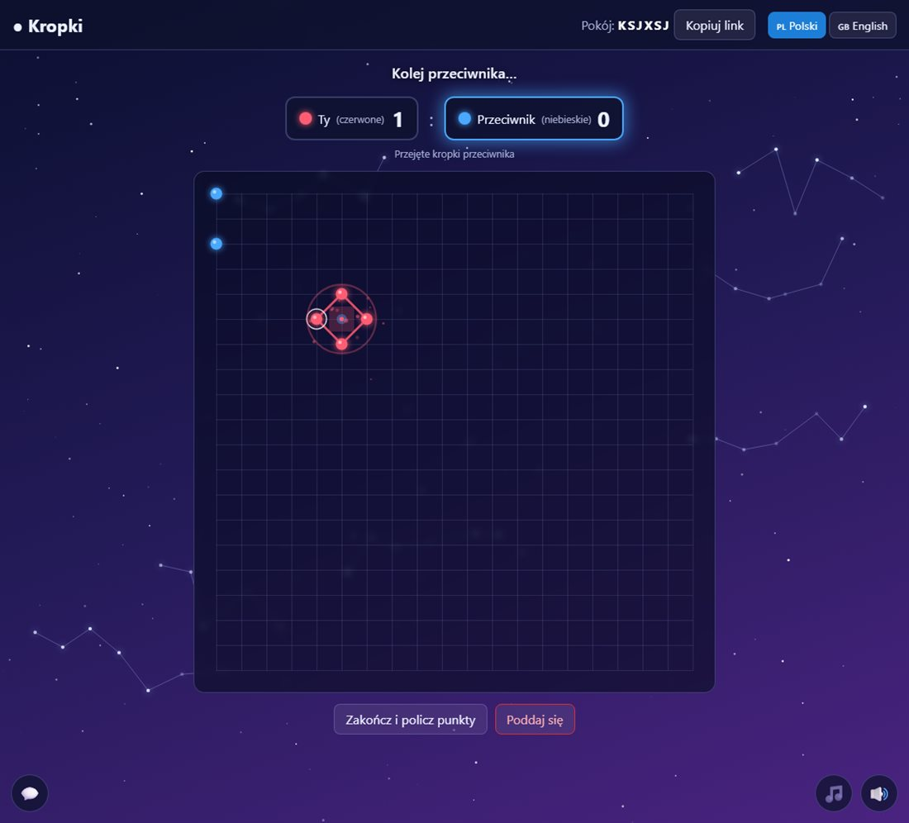

  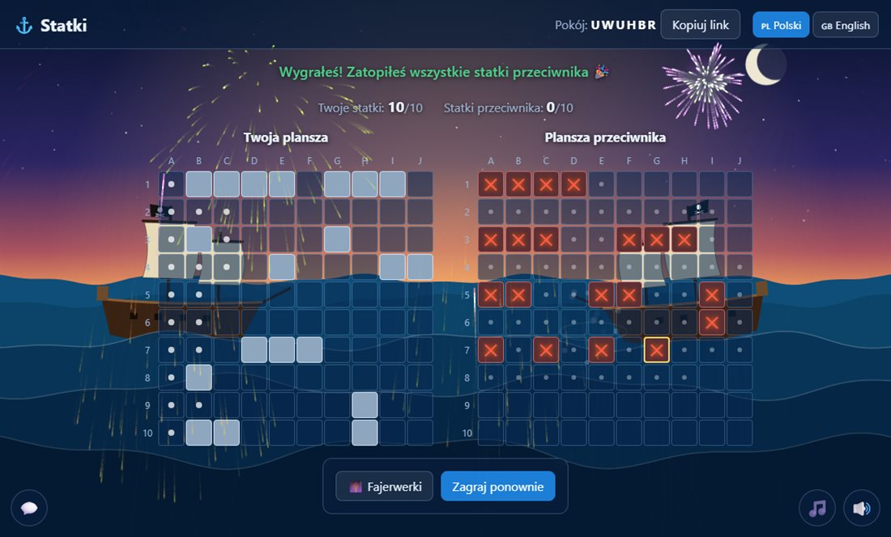
  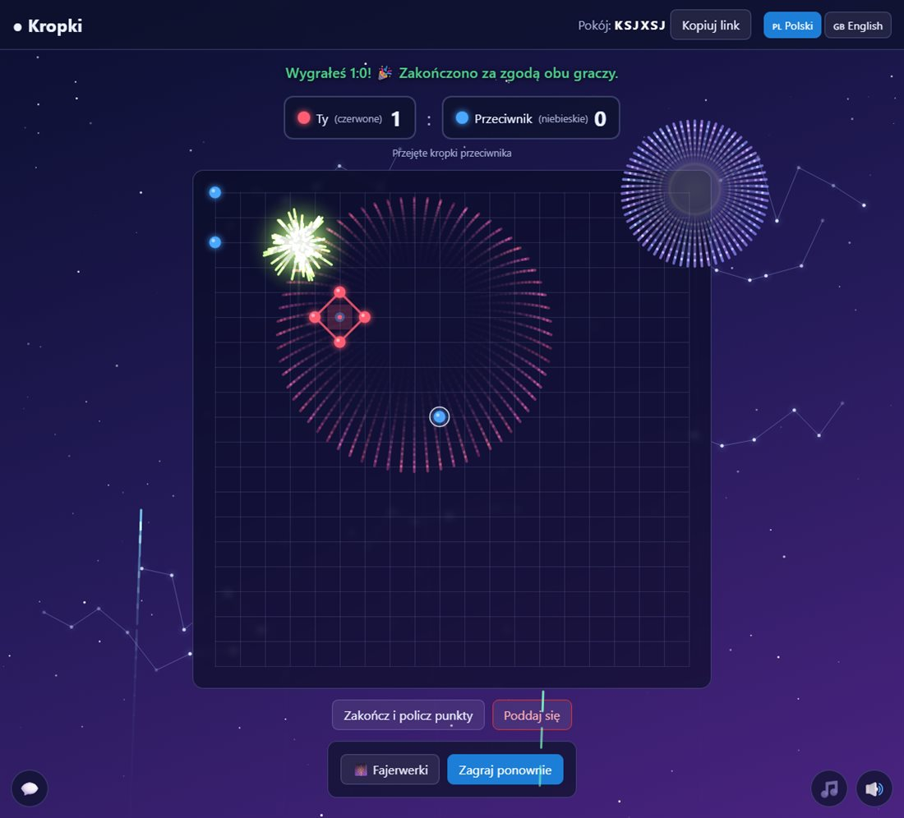

  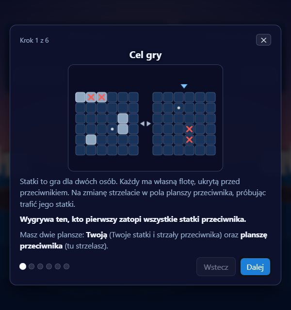
  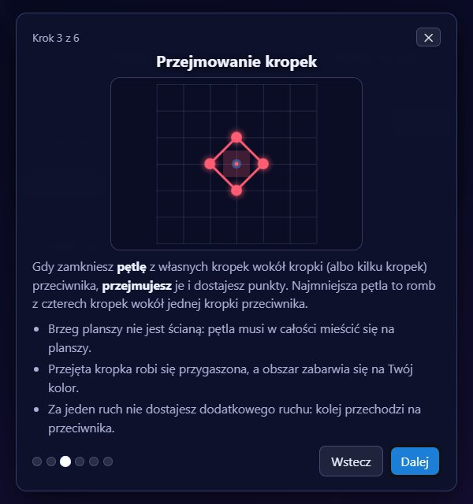

  
  

  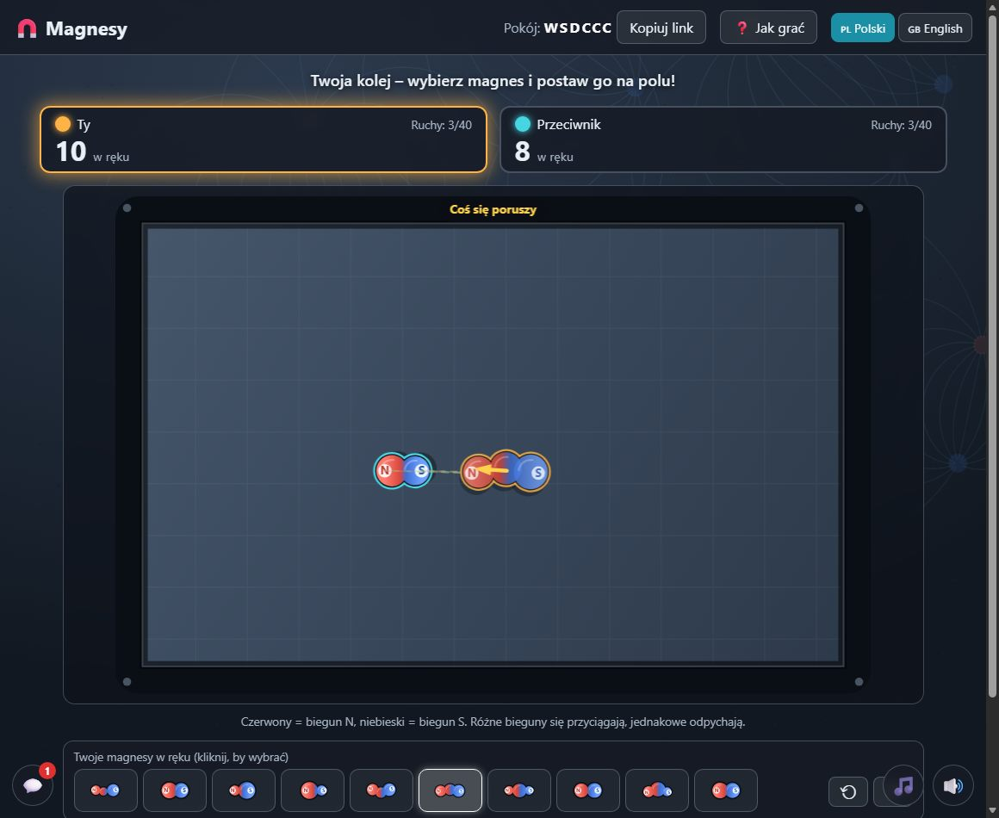
  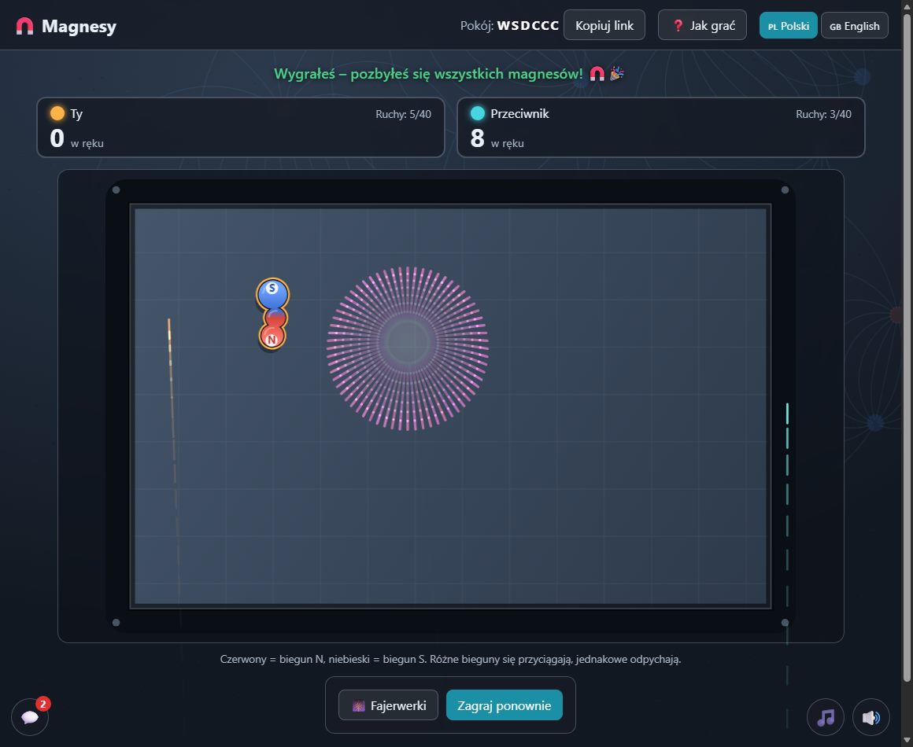

### Szybki start (Windows)
1. Zainstaluj **Node.js** 18 lub nowszy (LTS) z <https://nodejs.org>.
2. Pobierz repozytorium: `git clone https://github.com/YeezyBuck/Browser-Games.git` (albo ZIP z GitHuba).
3. Wejdź do folderu wybranej gry i kliknij dwukrotnie **`uruchom.bat`**. Sprawdzi on program `cloudflared` (w razie potrzeby zaproponuje instalację), uruchomi tunel, a potem grę i przeglądarkę. Wariant bez internetu: `uruchom-bez-tunelu.bat`.
4. Utwórz grę, a przeciwnikowi wyślij link albo pokaż kod QR. Na koniec kliknij **⏻ Zamknij grę**.

Na innych systemach: `cd WarShips` (albo `cd Dots`, `cd CapRace`, `cd Magnets`), potem `node server.js --tunnel --open`. Kółko i krzyżyk nie wymaga serwera. Wszystkie gry sieciowe mogą działać jednocześnie (różne porty). Szczegóły i rozwiązywanie problemów są w instrukcjach poszczególnych gier.

### Jak to jest zbudowane
- Serwery to czysty Node.js (bez `npm install`): statyczne pliki, stan na żywo przez SSE z zapasowym long-pollingiem (działa przez tunel), ruchy przez POST. **Serwer jest sędzią**: sprawdza każdy ruch, a przeciwnik nigdy nie dostaje danych, których nie powinien znać.
- Zabezpieczenia: 6-literowe kody pokoi z limitem prób, limity żądań na adres IP, Content-Security-Policy, czat tylko jako zwykły tekst, wyłączanie serwera tylko z lokalnego komputera z tajnym tokenem. Zobacz [SECURITY.md](SECURITY.md).
- Każda gra ma testy: `npm test` w jej folderze (WarShips: 74 testy, Dots: 11 testów silnika i 53 testy serwera, CapRace: 31 testów silnika i 61 testów serwera, Magnets: 29 testów silnika i 62 testy serwera, TicTacToe: 7 testów).

### Ważne
Gry są przeznaczone do grania ze znajomymi: serwer działa na Twoim komputerze, a tunel Cloudflare „quick” jest tymczasowy i przeznaczony do testów. **Nie są przygotowane do stałego hostowania publicznego** (nie ma kont; każdy, kto zna kod pokoju, może dołączyć jako drugi gracz).

### Licencja
[MIT](LICENSE), Copyright (c) 2026 YeezyBuck. Dołączona biblioteka kodów QR (`qrcode-generator`) ma własną licencję MIT: [THIRD_PARTY_NOTICES.md](THIRD_PARTY_NOTICES.md). Zgłoszenia błędów i propozycje są mile widziane w zakładce Issues; zasady współtworzenia: [CONTRIBUTING.md](CONTRIBUTING.md), [Kodeks postępowania](CODE_OF_CONDUCT.md), zgłaszanie luk: [SECURITY.md](SECURITY.md).

## English

A small collection of games you play in the browser, written from scratch with **no external libraries** (the only bundled third-party code is a QR code generator, see [THIRD_PARTY_NOTICES.md](THIRD_PARTY_NOTICES.md)). The two-player games work on your home network **or over the internet** through a Cloudflare tunnel, and have a chat, a QR code for joining from a phone, a Polish and English interface, an **in-game tutorial (the ❓ How to play button)**, sounds and music synthesized in the browser, and canvas animations.

| Game | Description | Folder | Port | Instructions |
|---|---|---|---|---|
| ⚓ **WarShips** (Battleships) | the classic two-player Battleships; explosions on the ships, fireworks for the winner, a pirate scene in the background | [`WarShips/`](WarShips/) | 3000 | [PL](WarShips/README.pl.md) · [EN](WarShips/README.md) |
| ● **Dots** | the Polish "Dots" game (surround and capture): a loop of your own dots captures your opponent's dots; night sky with constellations | [`Dots/`](Dots/) | 3100 | [PL](Dots/README.pl.md) · [EN](Dots/README.md) |
| 🏁 **CapRace** (bottle-cap racing) | bottle-cap racing along a random chalk-drawn track: flick with the mouse, the hit spot gives spin, the pull gives power; the server computes the physics | [`CapRace/`](CapRace/) | 3200 | [PL](CapRace/README.pl.md) · [EN](CapRace/README.md) |
| 🧲 **Magnets** | each player has 10 irregular magnets and places them in turns on a small field; magnets attract, and joined ones return to the player who caused it; whoever gets rid of all of them first wins | [`Magnets/`](Magnets/) | 3300 | [PL](Magnets/README.pl.md) · [EN](Magnets/README.md) |
| ✕ ○ **TicTacToe** | play against the computer (minimax) in a single `index.html`, just open it | [`TicTacToe/`](TicTacToe/) | – | [README](TicTacToe/README.md) |

  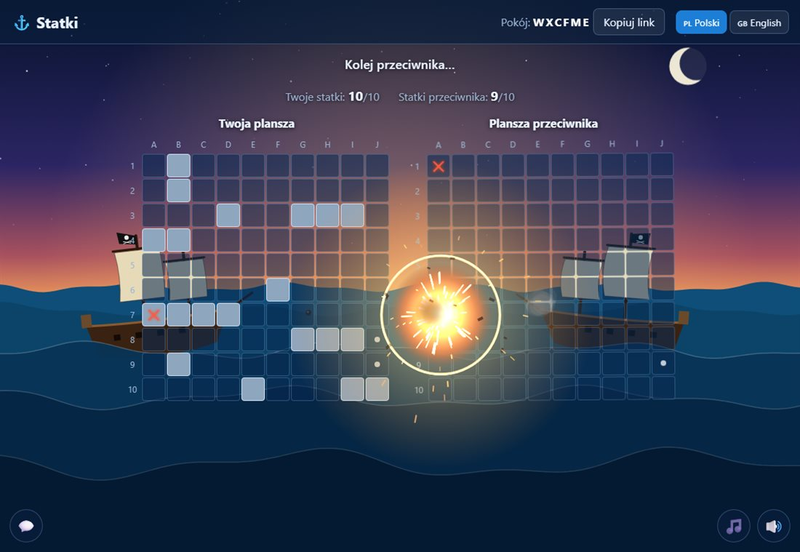
  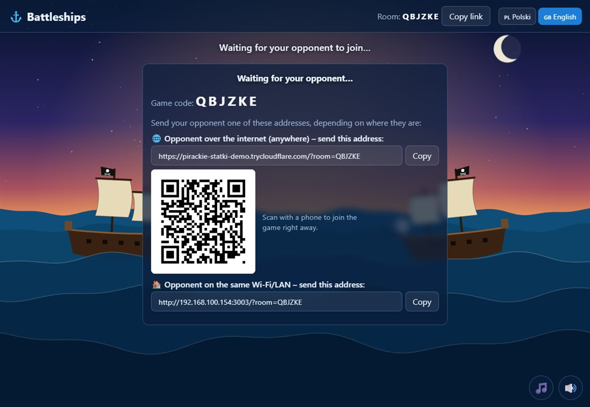

  
  

  
  

  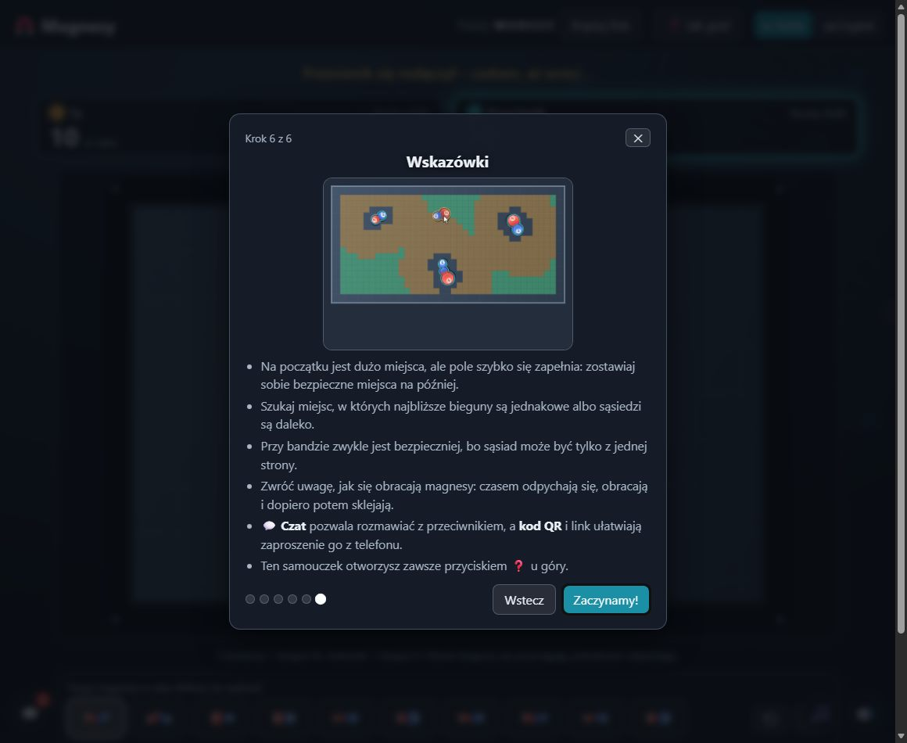
  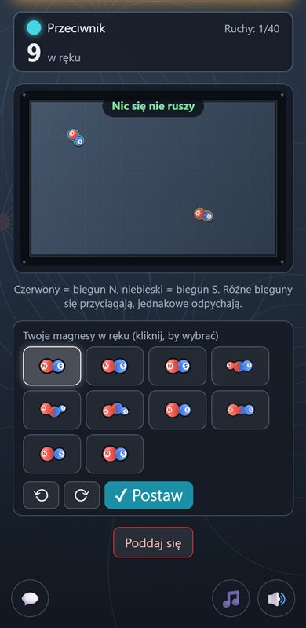

### Quick start (Windows)
1. Install **Node.js** 18 or newer (LTS) from <https://nodejs.org>.
2. Get the repository: `git clone https://github.com/YeezyBuck/Browser-Games.git` (or the ZIP from GitHub).
3. Open the folder of the game you want and double-click **`uruchom.bat`**. It checks for `cloudflared` (offering to install it if needed), starts the tunnel, then the game and the browser. Without the internet: `uruchom-bez-tunelu.bat`.
4. Create a game and send your opponent the link or show the QR code. When you are done, click **⏻ Quit game**.

On other systems: `cd WarShips` (or `cd Dots`, `cd CapRace`, `cd Magnets`), then `node server.js --tunnel --open`. Tic-tac-toe needs no server. All the multiplayer games can run at the same time (different ports). Details and troubleshooting are in each game's instructions.

### How it is built
- The servers are plain Node.js (no `npm install`): static files, live state over SSE with a long-polling fallback (works through the tunnel), moves over POST. **The server is the referee**: it validates every move, and your opponent never receives data they should not know.
- Protections: 6-letter room codes with rate limits, per-IP request limits, a Content-Security-Policy, plain-text-only chat, and a shutdown endpoint reachable only from the local machine with a secret token. See [SECURITY.md](SECURITY.md).
- Every game has tests: `npm test` in its folder (WarShips: 74 tests, Dots: 11 engine tests and 53 server tests, CapRace: 31 engine tests and 61 server tests, Magnets: 29 engine tests and 62 server tests, TicTacToe: 7 tests).

### Important
The games are meant for playing with friends: the server runs on your computer, and the "quick" Cloudflare tunnel is temporary and intended for testing. **They are not hardened for permanent public hosting** (there are no accounts; anyone who knows a room code can join as the second player).

### License
[MIT](LICENSE), Copyright (c) 2026 YeezyBuck. The bundled QR code library (`qrcode-generator`) has its own MIT license: [THIRD_PARTY_NOTICES.md](THIRD_PARTY_NOTICES.md). Bug reports and suggestions are welcome in the Issues tab; see [CONTRIBUTING.md](CONTRIBUTING.md), the [Code of Conduct](CODE_OF_CONDUCT.md) and [SECURITY.md](SECURITY.md) for reporting vulnerabilities.
