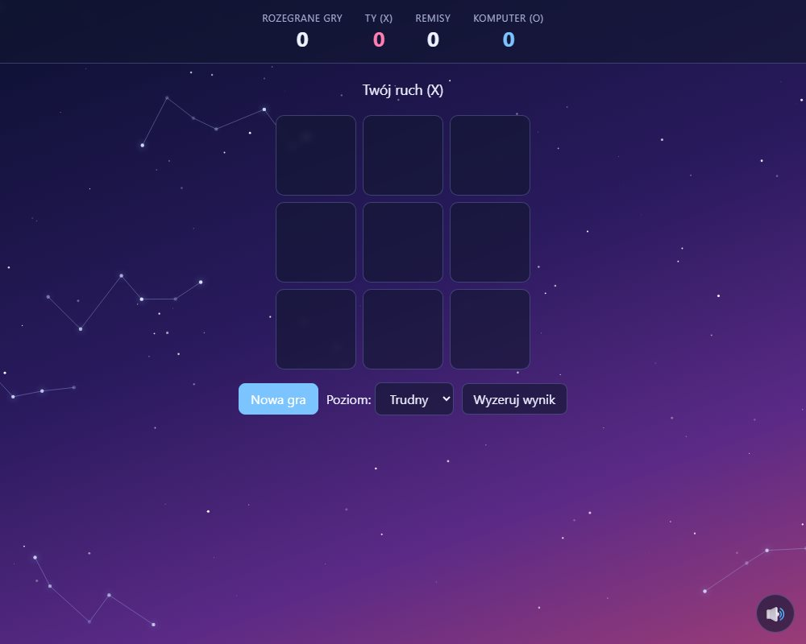
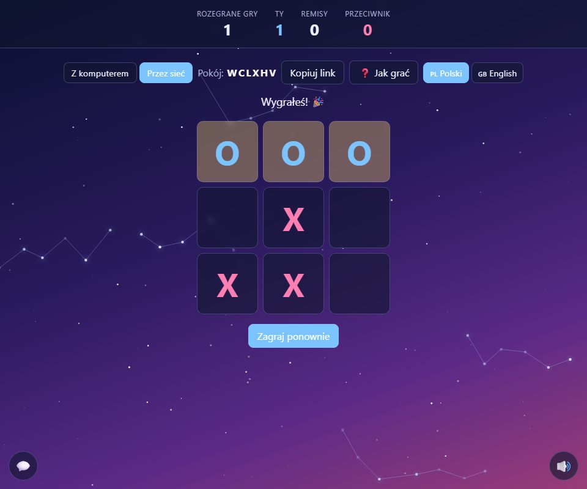
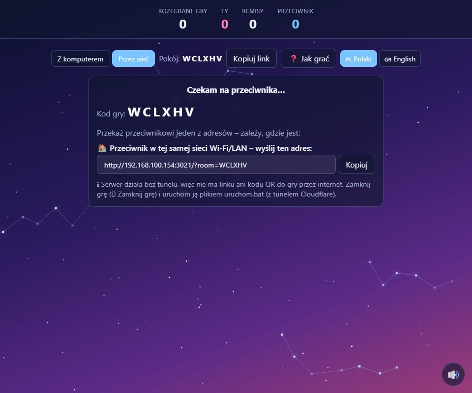

# ✕ ○ Tic-tac-toe / Kółko i krzyżyk

🇬🇧 Play against the computer **or over the network with a friend**. Against the computer you only need to open [`index.html`](index.html) in a browser (no installation, no server). To play with another person, start the small Node.js server (`uruchom.bat`) and pick **Over the network** in the same page. The interface is in Polish and English.

🇵🇱 Gra przeciwko komputerowi **albo przez sieć ze znajomym**. Z komputerem wystarczy otworzyć [`index.html`](index.html) w przeglądarce (bez instalacji i serwera). Żeby zagrać z drugą osobą, uruchom mały serwer Node.js (`uruchom.bat`) i wybierz **Przez sieć** na tej samej stronie. Interfejs jest po polsku i angielsku.

<p align="center">
  
  
  
</p>

## Quick start / Szybki start

| | Against the computer / Z komputerem | Over the network / Przez sieć |
|---|---|---|
| **Needs / Potrzebne** | just a browser / tylko przeglądarka | Node.js 18+ |
| **Start / Uruchomienie** | open `index.html` / otwórz `index.html` | double-click **`uruchom.bat`** (with the Cloudflare tunnel, for the internet) or **`uruchom-bez-tunelu.bat`** (home network only); terminal: `cd TicTacToe`, `node server.js --tunnel --open` / dwuklik **`uruchom.bat`** (z tunelem Cloudflare, do gry przez internet) albo **`uruchom-bez-tunelu.bat`** (tylko sieć domowa); terminal: `cd TicTacToe`, `node server.js --tunnel --open` |
| **Port** | – | **3400** (`PORT=3500 node server.js` for another / dla innego) |

**Playing over the network, step by step / Gra przez sieć, krok po kroku**

1. **EN:** Start the server (`uruchom.bat`). The page opens at `http://localhost:3400`. **PL:** Uruchom serwer (`uruchom.bat`). Strona otworzy się pod adresem `http://localhost:3400`.
2. **EN:** Click **Over the network** → **Create game**. A 6-letter code appears with ready links: 🌐 over the internet (with a **QR code**) and 🏠 on the home network. **PL:** Kliknij **Przez sieć** → **Utwórz grę**. Pojawi się 6-literowy kod i gotowe linki: 🌐 przez internet (z **kodem QR**) i 🏠 w sieci domowej.
3. **EN:** Send the link to your friend, who opens it (or types the code under **Join a game**; on a phone they can scan the QR code). **PL:** Wyślij link znajomemu, który go otwiera (albo wpisuje kod w polu **Dołącz do gry**; z telefonu może zeskanować kod QR).
4. **EN:** Play. A toast reminds you which mark you have in this game. After a game both players click **Play again** for a rematch. **PL:** Grajcie. Krótki komunikat przypomina, jakim znakiem grasz w tej grze. Po grze obaj klikają **Zagraj ponownie**, żeby zagrać rewanż.
5. **EN:** When you finish, click **⏻ Quit game** (only in the browser on the computer running the server): it shuts down the server and the tunnel. **PL:** Na koniec kliknij **⏻ Zamknij grę** (tylko w przeglądarce na komputerze z serwerem): wyłącza serwer i tunel.

## Features / Funkcje

- **Against the computer:** you play X, the computer plays O; who starts alternates every game. **Hard**: the minimax algorithm (it cannot be beaten, at best you draw). **Easy**: it often plays a random move. / **Z komputerem:** Ty grasz X, komputer O; kto zaczyna, zmienia się co grę. **Trudny**: minimax (nie da się go pokonać, co najwyżej zremisować). **Łatwy**: często gra losowo.
- **Over the network:** two players, **X always starts and the marks swap every game** (rematch: the player who was X becomes O, and the new X starts). The server is the referee: it checks the turn, the cell and the win. / **Przez sieć:** dwóch graczy, **zawsze zaczyna X, a znaki zamieniają się co grę** (rewanż: dotychczasowy X gra O, a nowy X zaczyna). Serwer jest sędzią: sprawdza kolejkę, pole i wygraną.
- **Series score:** games played, wins of each player and draws are counted for the whole series (against the computer it is remembered in the browser). In the network game it is counted per player, not per mark. / **Wynik serii:** liczba gier, wygrane każdego gracza i remisy dla całej serii (z komputerem zapamiętywane w przeglądarce). W grze sieciowej liczone na graczach, nie na znakach.
- **Chat**, a **QR code** and the link for inviting a friend from a phone, a **Cloudflare tunnel** with automatic `cloudflared` installation, and a **⏻ Quit game** button, like in the other games. / **Czat**, **kod QR** i link do zaproszenia znajomego z telefonu, **tunel Cloudflare** z automatyczną instalacją `cloudflared` oraz przycisk **⏻ Zamknij grę**, jak w pozostałych grach.
- Night sky with twinkling stars and slowly drifting constellations (static with "reduce motion"). / Nocne niebo z gwiazdami i konstelacjami (statyczne przy „ogranicz ruch”).
- Calm background music synthesized in the browser (starts after the first click; the 🔊/🔇 button mutes it and the choice is remembered), and small sound effects for moves in the network game. / Spokojna muzyka generowana w przeglądarce (startuje po pierwszym kliknięciu; przycisk 🔊/🔇 ją wycisza) oraz drobne dźwięki ruchów w grze sieciowej.
- **❓ How to play** tutorial with short animations (3 steps, opens on your first visit). / Samouczek **❓ Jak grać** z krótkimi animacjami (3 kroki, otwiera się przy pierwszej wizycie).
- **Polski / English** switch for the whole interface, remembered in the browser. / Przełącznik **Polski / English** dla całego interfejsu, zapamiętywany w przeglądarce.

## Security / Bezpieczeństwo

- **EN:** The page is a single `index.html` with inline scripts, so the server computes the **SHA-256 hashes** of those scripts and the style at runtime and puts them in the `Content-Security-Policy` header: no `unsafe-inline`, no `unsafe-eval`, scripts and connections only from the game itself. Only three files are served (`index.html`, `online.js`, `vendor/qrcode.js`; nothing else from the folder). The network code (`online.js`) is loaded only when the page runs through the server, so opening `index.html` from the disk keeps working exactly as before.
- **PL:** Strona to jeden `index.html` z wbudowanymi skryptami, więc serwer na bieżąco liczy **skróty SHA-256** tych skryptów i stylu i wpisuje je do nagłówka `Content-Security-Policy`: bez `unsafe-inline` i `unsafe-eval`, skrypty i połączenia tylko z samej gry. Serwowane są tylko pliki z krótkiej listy (`index.html`, `online.js`, `vendor/qrcode.js`; nic więcej z folderu). Kod sieciowy (`online.js`) ładuje się tylko wtedy, gdy strona działa przez serwer, więc otwarcie `index.html` z dysku działa jak dotychczas.
- **EN/PL:** 6-letter room code and the same limits as in the other games (join attempts, rooms, requests, moves, chat, connections), plain-text chat, a shutdown endpoint only from the local computer with a secret token. No accounts: anyone who knows the code can join as the second player. / 6-literowy kod pokoju i takie same limity jak w pozostałych grach (próby dołączenia, pokoje, żądania, ruchy, czat, połączenia), czat tylko jako tekst, wyłączanie serwera tylko z lokalnego komputera z tajnym tokenem. Brak kont: każdy, kto zna kod, może dołączyć jako drugi gracz.

## Tests / Testy

```
cd TicTacToe
npm test            # = node test.js && node server.test.js
```
- `test.js` (12): translations PL/EN (tutorial, network mode, error codes), compatibility with the strict CSP (no `style=`/`onclick`, no HTML injection), and a check that the hard level never loses in 300 random games. / `test.js` (12): tłumaczenia PL/EN (samouczek, tryb sieciowy, kody błędów), zgodność ze ścisłym CSP (brak `style=`/`onclick`, brak wstawiania HTML) oraz sprawdzenie, że poziom trudny nie przegrywa w 300 losowych partiach.
- `server.test.js` (46): the server over HTTP: CSP hashes and the list of served files, rooms, X/O draw, move validation, win/draw/resign, the swap of marks and the series score, long-polling, chat, limits, security and shutdown. / `server.test.js` (46): serwer przez HTTP: skróty CSP i lista serwowanych plików, pokoje, losowanie X/O, walidacja ruchów, wygrana/remis/poddanie, zamiana znaków i wynik serii, long-polling, czat, limity, zabezpieczenia i zamykanie.

## Project structure / Struktura projektu

```
TicTacToe/
├── index.html             the whole game against the computer (inline scripts and styles) + the screens of the network mode
├── online.js              network client (loaded only when served by server.js)
├── server.js              HTTP server: rooms, turns, series score, CSP with hashes, tunnel, shutdown (no dependencies)
├── test.js, server.test.js tests
├── package.json           scripts: start, local, test
├── uruchom.bat            main start (Windows): cloudflared → tunnel → game → browser
├── uruchom-bez-tunelu.bat start without a tunnel, home network only (Windows)
└── vendor/qrcode.js       QR code generator (qrcode-generator, MIT, bundled unchanged)
```

**HTTP interface / Interfejs HTTP:** `POST /api/create`, `/api/join`, `/api/move` (`{cell: 0-8}`), `/api/resign`, `/api/rematch`, `/api/chat`, `/api/shutdown`; `GET /api/events` (SSE) / `/api/poll` (long-polling) / `/api/state`, `/api/info`. Errors: `{ "code": "…", "error": "…" }`.

## License / Licencja

MIT, see [LICENSE](../LICENSE). The bundled QR code library has its own MIT license: [THIRD_PARTY_NOTICES.md](../THIRD_PARTY_NOTICES.md). / MIT, zobacz [LICENSE](../LICENSE). Dołączona biblioteka kodów QR ma własną licencję MIT: [THIRD_PARTY_NOTICES.md](../THIRD_PARTY_NOTICES.md).
